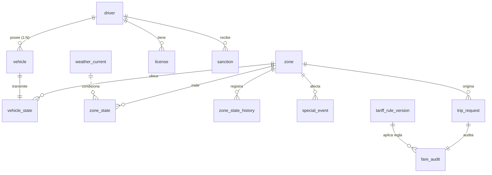
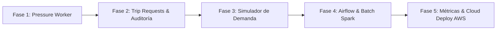

# RutaViva Mobility · Documentación Técnica Integral del Sistema

> **Versión**: 1.0.0  
> **Área**: Plataforma de Ingeniería de Datos, Backend y Operaciones de Flota  
> **Objetivo**: Documento maestro de arquitectura, especificación de módulos, contratos de datos, reglas de negocio y guía de extensiones/mejoras futuras.

---

## 📑 Tabla de Contenidos

1. [Visión General y Propósito del Sistema](#1-visión-general-y-propósito-del-sistema)
2. [Arquitectura Global de la Solución](#2-arquitectura-global-de-la-solución)
3. [Modelo de Datos Operacional (PostgreSQL)](#3-modelo-de-datos-operacional-postgresql)
4. [Análisis Detallado de Módulos](#4-análisis-detallado-de-módulos)
   - [4.1 Módulo de Infraestructura (`infra/`)](#41-módulo-de-infraestructura-infra)
   - [4.2 Módulo Seed CLI (`services/seed_cli/`)](#42-módulo-seed-cli-servicesseed_cli)
   - [4.3 Módulo Simulador de Telemetría (`services/telemetry_simulator/`)](#43-módulo-simulador-de-telemetría-servicestelemetry_simulator)
   - [4.4 Módulo Multiplier API (`services/multiplier_api/`)](#44-módulo-multiplier-api-servicesmultiplier_api)
   - [4.5 Módulo Pressure Worker (`services/pressure_worker/`)](#45-módulo-pressure-worker-servicespressure_worker---en-desarrollo)
   - [4.6 Módulo Simulador de Solicitudes (`services/request_simulator/`)](#46-módulo-simulador-de-solicitudes-servicesrequest_simulator---en-desarrollo)
   - [4.7 Módulo Batch Processing (`batch/`)](#47-módulo-batch-processing-batch---en-desarrollo)
5. [Reglas de Negocio y Requisitos No Funcionales](#5-reglas-de-negocio-y-requisitos-no-funcionales)
6. [Guía de Desarrollo y Convenciones del Código](#6-guía-de-desarrollo-y-convenciones-del-código)
7. [Hoja de Ruta para Futuras Mejoras (Pair Programming Roadmap)](#7-hoja-de-ruta-para-futuras-mejoras-pair-programming-roadmap)

---

## 1. Visión General y Propósito del Sistema

El sistema **RutaViva Mobility** es una plataforma end-to-end de movilidad diseñada para optimizar la relación entre **oferta vehicular** y **demanda de pasajeros** en tiempo real. 

### El Problema
Los modelos de tarifas fijas o segmentadas de manera estática provocan:
- **Tiempos de espera excesivos** para los pasajeros ante condiciones climáticas adversas (lluvia) o picos de demanda.
- **Incentivos desalineados** para los conductores (vehículos ociosos en zonas de baja demanda y desabastecimiento en zonas críticas).
- **Falta de auditabilidad** en cómo y por qué se fijó el precio de una carrera en un segundo determinado.
- **Dificultad de procesamiento** analítico sobre terabytes de datos históricos de viajes (NYC TLC Trips).

### La Solución
RutaViva implementa una arquitectura híbrida:
- **Streaming / Tiempo Real**: Ingesta masiva de telemetría GPS cada 15 segundos mediante RabbitMQ, cálculo reactivo de presión de demanda por zona geográfica, y entrega de multiplicadores dinámicos ($1.0 \times \dots 2.0\times$) vía una API REST de baja latencia con fallback por degradación segura.
- **Auditoría Transaccional**: Registro inmutable de cada decisión tarifaria (`fare_audit`) atada a versiones de reglas vigentes (`tariff_rule_version`).
- **Batch & Data Lake**: Pipelines en Apache Spark y Apache Airflow para unificar datos históricos masivos, ingerir condiciones climáticas y generar reportes regulatorios automatizados.

---

## 2. Arquitectura Global de la Solución

```mermaid
flowchart TB
    subgraph Data Generation & Seed
        A[GeoJSON / Shapefiles TLC] --> Seed[services/seed_cli]
        Seed -->|Bulk Insert / Idempotente| DB[(PostgreSQL 16)]
    end

    subgraph Streaming & Real-Time Processing
        DB -.->|Leer vehículos activos| SimTele[services/telemetry_simulator]
        SimTele -->|Eventos GPS c/15s| Rabbit[(RabbitMQ 3.12\nExchange telemetria.viajes)]
        Rabbit -->|Queue telemetria.vehiculos| Worker[services/pressure_worker]
        SimReq[services/request_simulator] -->|POST /trip-requests| API[services/multiplier_api]
        Worker -->|Update vehicle_state & zone_state| DB
    end

    subgraph Serving & Auditing
        Passenger[App Pasajero / Conductor] -->|GET /zones/{id}/multiplier| API
        API <-->|Lectura directa zone_state| DB
        API -->|Insert trip_request & fare_audit| DB
    end

    subgraph Analytics & Batch Processing
        DB -.-> SparkJobs[batch/spark_jobs\nPySpark ETL]
        Airflow[batch/dags\nAirflow Scheduler] -->|Trigger| SparkJobs
        OpenMeteo[API Externa Clima] -->|DAG Horario| Airflow
        Airflow -->|Carga weather_current| DB
    end
```

---

## 3. Modelo de Datos Operacional (PostgreSQL)

El esquema operacional consta de 13 tablas relacionales estructuradas en 4 dominios funcionales:



### Detalle de Entidades Principales

| Dominio | Tabla | Clave Primaria | Propósito y Características |
|---|---|---|---|
| **Catálogos y Reglas** | `zone` | `zone_id` (INT) | 265 zonas oficiales de la NYC Taxi & Limousine Commission (TLC). Mapea `borough` y `zone_name`. |
| | `tariff_rule_version` | `rule_version_id` (INT) | Reglas dinámicas vigentes versionadas con rangos de fechas (`valid_from`, `valid_to`) y umbrales en `JSONB`. |
| | `weather_current` | `valid_hour` (TIMESTAMPTZ) | Registro horario de precipitación pluvial (`rain_mm_h`). Evita llamadas síncronas a APIs de clima durante la cotización. |
| **Flota y Conductores** | `driver` | `driver_id` (UUID) | Registro de conductores con estados (`active`, `inactive`, `suspended`). |
| | `vehicle` | `vehicle_id` (UUID) | Vehículos con matrícula única (`plate`), vinculados a su conductor. |
| | `license` | `license_id` (UUID) | Licencia de conducción y fecha de expiración (`expires_on`). |
| | `sanction` | `sanction_id` (UUID) | Sanciones disciplinarias con vigencia temporal (`starts_on`, `ends_on`). |
| **Tiempo Real** | `vehicle_state` | `vehicle_id` (UUID) | Posición más reciente de cada móvil (`latitude`, `longitude`), zona actual (`zone_id`), estado (`status`) y timestamp (`last_seen_at`). |
| | `zone_state` | `zone_id` (INT) | Estado instantáneo de cada zona: `computed_at`, `pressure_index`, `multiplier` (1.00 a 2.00), `free_vehicles` y `requests_last_10min`. |
| | `zone_state_history` | `(zone_id, interval_start)` | Serie temporal particionable de evolución de presión y tiempos estimados de espera por zona. |
| | `special_event` | `event_id` (UUID) | Eventos masivos y emergencias (`is_emergency = true` congela el multiplicador a 1.0 por normativa). |
| **Transaccional & Auditoría** | `trip_request` | `trip_id` (UUID) | Solicitudes de viaje generadas por usuarios en una zona con estado del viaje. |
| | `fare_audit` | `trip_id` (UUID) | Registro inmutable de tarifa base, multiplicador aplicado, tarifa cobrada, índice de presión, clima y versión de regla aplicada. |

---

## 4. Análisis Detallado de Módulos

### 4.1 Módulo de Infraestructura (`infra/`)
- **Directorio**: `infra/migrations/`
- **Herramienta**: Alembic 1.20+
- **Función**: Control de versiones y evolución del esquema DDL en PostgreSQL.
- **Aspectos Técnicos Clave**:
  - Índices explícitos para FKs y consultas críticas de alta concurrencia (`ix_vehicle_state_zone`, `ix_special_event_zone`).
  - Restricciones de integridad (Constraints): Validaciones de rangos para multiplicador `BETWEEN 1.0 AND 2.0`, valores positivos de lluvia y tarifas, y coherencia de vigencias temporales.

---

### 4.2 Módulo Seed CLI (`services/seed_cli/`)
- **Directorio**: `services/seed_cli/`
- **Punto de Entrada**: `services/seed_cli/app/main.py`
- **Función**: Ingestión, generación sintética y poblamiento inicial de datos base con reproducibilidad matemática.
- **Componentes**:
  - `seeder.py`: Utiliza `Faker`, `NumPy` y generadores de UUID deterministas (o con semilla fija `SEED`) para poblar conductores, licencias, sanciones y vehículos.
  - `data/shapefiles/taxi_zones.shp` y `data/geojson/sync_taxi_zones.geojson`: Polígonos geográficos de Nueva York para ubicar vehículos físicamente dentro de las zonas delimitadas.
  - `apply_driver_status()`: Valida coherencia legal (un conductor con licencia vencida o sanción activa pasa a estado correspondiente).
  - Inserción en chunks (5,000 registros) con `pg_insert().on_conflict_do_nothing()`, garantizando idempotencia.

---

### 4.3 Módulo Simulador de Telemetría (`services/telemetry_simulator/`)
- **Directorio**: `services/telemetry_simulator/`
- **Punto de Entrada**: `services/telemetry_simulator/app/telemetry_generator.py`
- **Función**: Emular la operación cinemática en vivo de miles de vehículos enviando pulsos GPS cada 15 segundos.
- **Componentes**:
  - `vehicle_repository.py`: Carga el estado inicial de la flota desde `vehicle_state`.
  - `vehicle.py`: Modela la cinemática de cada vehículo (velocidad 5-60 km/h, rumbo angular con perturbaciones gaussianas, rebote en fronteras de la ciudad y transiciones de estado markovianas entre `available`, `busy`, `offline`, `maintenance`).
  - `zone_locator.py`: Mantiene un índice espacial R-Tree en memoria vía `GeoPandas` para resolver en microsegundos qué polígono de zona de taxi contiene la coordenada actual $(lat, lon)$.
  - `rabbit_publisher.py`: Cliente asíncrono sobre `aio-pika`. Utiliza un semáforo de concurrencia (`asyncio.Semaphore(MAX_CONCURRENCIA)`) y publica lotes no persistentes (`DeliveryMode.NOT_PERSISTENT`) al exchange `telemetria.viajes` para un throughput óptimo.

---

### 4.4 Módulo Multiplier API (`services/multiplier_api/`)
- **Directorio**: `services/multiplier_api/`
- **Punto de Entrada**: `services/multiplier_api/app/main.py`
- **Función**: Microservicio REST síncrono encargado de cotizar tarifas y consultar el estado de zonas.
- **Patrón de Arquitectura**: Capas estrictas con flujo unidireccional:
  $$\text{Router} \longrightarrow \text{Service} \longrightarrow \text{Repository} \longrightarrow \text{Model}$$
- **Manejo de Degradación Segura (RNF-04)**:
  - En `services/multiplier_service.py`, si la zona existe pero no tiene cálculo en `zone_state`, o el timestamp `computed_at` excede `FRESHNESS_THRESHOLD_SECONDS` (por defecto 300 s), la API devuelve un multiplicador neutro `1.0` con la bandera `degraded: true`.
  - Solo si la zona no existe en el catálogo maestro (`zone`), se genera un error `404 Not Found`.

---

### 4.5 Módulo Pressure Worker (`services/pressure_worker/` - En desarrollo)
- **Directorio**: `services/pressure_worker/`
- **Función**: Worker en segundo plano que consumirá la cola `telemetria.vehiculos` de RabbitMQ.
- **Responsabilidades a implementar**:
  1. Recibir pulsos de telemetría y actualizar la posición en `vehicle_state`.
  2. Ventana deslizante de tiempo: Contar vehículos en estado `available` por zona en los últimos minutos (con descarte de móviles sin señal $> 2$ min según RN-10).
  3. Contar solicitudes recientes (`requests_last_10min`).
  4. Calcular el índice de presión:
     $$\text{Presión} = \frac{\text{Demanda}}{\max(\text{Oferta}, 1)}$$
  5. Ajustar por lluvia (si $rain > 2.0\text{ mm/h}$) y validar eventos de emergencia (`special_event`).
  6. Persistir el resultado atómico en `zone_state` e historizar en `zone_state_history`.

---

### 4.6 Módulo Simulador de Solicitudes (`services/request_simulator/` - En desarrollo)
- **Directorio**: `services/request_simulator/`
- **Función**: Simular tráfico de usuarios pasajeros creando viajes.
- **Responsabilidades a implementar**:
  - Generar solicitudes sintéticas llamando a `POST /trip-requests` de la `multiplier_api`.
  - Permitir simulación con perfiles de carga (horas pico vs. horas valle) para evaluar la reacción del multiplicador dinámico.

---

### 4.7 Módulo Batch Processing (`batch/` - En desarrollo)
- **Directorio**: `batch/`
  - `dags/`: Orquestación con Apache Airflow.
  - `spark-jobs/`: Procesamiento distribuido con PySpark.
- **Responsabilidades a implementar**:
  - **Job 1 (Clean & Validate)**: Lectura de archivos Parquet/CSV masivos de viajes históricos (NYC Yellow Taxi Trip Data F1), validación de esquemas cambiantes, eliminación de registros anómalos (tarifas negativas, distancias cero).
  - **Job 2 (Enrich & Model)**: Enriquecimiento espacial con zonas y análisis de series temporales de demanda para calibrar las tablas de reglas de tarifa.
  - **DAG de Clima**: Consulta horaria a APIs de meteorología (p.ej. Open-Meteo) para alimentar la tabla `weather_current`.

---

## 5. Reglas de Negocio y Requisitos No Funcionales

| Código | Tipo | Descripción | Implementación en Código |
|---|---|---|---|
| **RN-01** | Regla Negocio | Multiplicador base neutral es 1.0. | `MultiplierResponse(multiplier=1.0)` |
| **RN-03** | Regla Negocio | Escalonamiento del multiplicador según índice de presión (1.0 hasta 2.0). | Calculador de tarifas en `multiplier_service` / `pressure_worker` |
| **RN-04** | Regla Negocio | Penalización por lluvia: factor multiplicador adicional cuando llueve. | Lectura de `weather_current.rain_mm_h` |
| **RN-05** | Regla Negocio | Tope tarifario regulatorio estricto: el multiplicador nunca puede superar 2.0. | Constraint DB `CHECK (multiplier BETWEEN 1.0 AND 2.0)` |
| **RN-06** | Regla Negocio | Congelamiento de tarifa por emergencia: ante catástrofes o emergencias declaradas, el multiplicador se fija en 1.0. | Evaluación de `special_event.is_emergency` |
| **RN-07** | Regla Negocio | Congelamiento al solicitar: el multiplicador cobrado es el vigente al momento exacto de `requested_at`. | Persistencia en `fare_audit` |
| **RN-09** | Regla Negocio | Conductor sin licencia vigente o con sanción activa no cuenta como oferta disponible. | Filtrado en `apply_driver_status()` y queries del worker |
| **RN-10** | Regla Negocio | Vehículo sin reporte GPS en los últimos 2 minutos se considera fuera de servicio / offline. | Timestamp `last_seen_at` comparado contra ventana móvil |
| **RN-12** | Regla Negocio | Trazabilidad inmutable de tarifas cobradas con versión de regla aplicada. | Registro obligatorio en `fare_audit` con FK a `tariff_rule_version` |
| **RNF-02** | No Funcional | Latencia de consulta de multiplicador $< 50\text{ ms}$ (p95). | Consulta por PK en `zone_state` e indexación de FKs |
| **RNF-04** | No Funcional | Tolerancia a fallos y degradación segura: si la BD falla o los datos están desactualizados, responder 1.0 con `degraded: true`. | `multiplier_service.py` (`degraded = True`) |

---

## 6. Guía de Desarrollo y Convenciones del Código

### Reglas de Arquitectura
1. **Separación de Capas**:
   - `routers/`: Solo interactúa con HTTP, parámetros de entrada, status codes y schemas Pydantic. Nunca importa modelos de BD directamente ni realiza consultas SQL.
   - `services/`: Contiene la lógica de negocio pura, cálculo de fallbacks y orquestación.
   - `repositories/`: Contiene exclusivamente operaciones de lectura/escritura en SQLAlchemy.
   - `models/`: Declaraciones ORM SQLAlchemy puras.
   - `schemas/`: Clases Pydantic de validación de entrada/salida.
2. **Fechas y Zonas Horarias**:
   - Todas las fechas en PostgreSQL son `TIMESTAMPTZ` o `TIMESTAMP` asumiendo UTC.
   - En Python, siempre manejar `datetime.now(timezone.utc)`. Al comparar contra campos naive, normalizar con `.replace(tzinfo=None)`.
3. **Monedas y Valores Numéricos**:
   - Precios y tarifas en base de datos deben usar `NUMERIC(10,2)` o `Decimal`, nunca floats binarios para evitar errores de redondeo.

---

## 7. Hoja de Ruta para Futuras Mejoras (Pair Programming Roadmap)

Cuando trabajes con el asistente de IA en este proyecto, estas son las tareas prioritarias organizadas por fase:



### 🎯 Fase 1: Implementación del `pressure_worker` (Streaming)
- [ ] Crear el consumidor asíncrono de RabbitMQ (`aio-pika`) escuchando en la cola `telemetria.vehiculos`.
- [ ] Implementar un actualizador batch hacia la tabla `vehicle_state` para amortiguar escrituras masivas en PostgreSQL.
- [ ] Crear el cálculo periódico del multiplicador por zona:
  - Contar vehículos `available` con `last_seen_at >= now() - interval '2 minutes'`.
  - Contar `trip_request` de los últimos 10 minutos.
  - Aplicar la fórmula de presión y factores climáticos de `weather_current`.
  - Actualizar `zone_state` y registrar entrada histórica en `zone_state_history`.

### 🎯 Fase 2: Endpoints Transaccionales en `multiplier_api`
- [ ] Implementar `POST /trip-requests`:
  - Recibe `zone_id` y `base_fare`.
  - Obtiene el multiplicador actual de la zona (o degradado si aplica).
  - Inserta el registro en `trip_request` y la traza inmutable en `fare_audit` en una sola transacción ACID.
- [ ] Implementar `GET /audit/{trip_id}`:
  - Reconstruye exactamente la tarifa, factores climáticos y versión de regla aplicada.
  - Opcional: Proteger con cabecera de autenticación básica/token para rol auditor.

### 🎯 Fase 3: Simulador de Demanda (`request_simulator`)
- [ ] Implementar generador de tráfico que llame a `POST /trip-requests` con curvas de Poisson simulando horas punta en zonas financieras o residenciales de NYC.

### 🎯 Fase 4: Pipeline Batch & Ingesta (Airflow & Spark)
- [ ] Configurar un DAG en Airflow que consulte periódicamente la API meteorológica (Open-Meteo) y actualice `weather_current`.
- [ ] Desarrollar `job1_clean_validate`: Script PySpark para limpiar y estandarizar datos históricos de NYC Yellow Taxi.
- [ ] Desarrollar `job2_enrich_model`: Enriquecer viajes con zonas y evaluar factores de demanda histórica.

### 🎯 Fase 5: Pruebas Automatizadas y Despliegue en AWS
- [ ] Tests unitarios y de integración con `pytest` y `TestClient` para toda la API.
- [ ] Dockerfiles multi-stage para cada microservicio.
- [ ] Configurar orquestación con ECS Fargate o Kubernetes (EKS) y RDS PostgreSQL en AWS.
