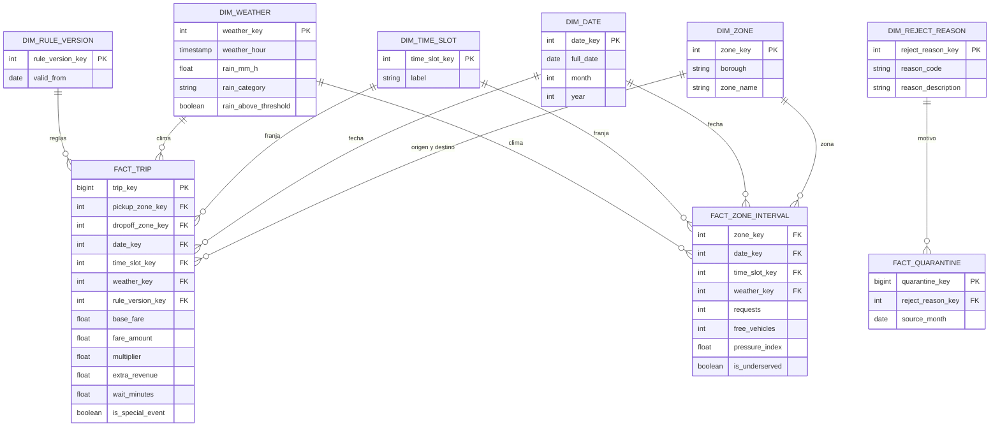

# Modelo Analítico Dimensional (Capa Gold)

El modelo dimensional implementa un esquema en constelación de hechos optimizado para responder a las preguntas estratégicas de negocio en **Power BI** a través de **Amazon Athena**.



---

## 1. Tablas de Hechos (Facts)

| Entidad                | Granularidad                     | Qué mide                                                                                          | Pregunta de negocio que responde                                                                                                        |
| ---------------------- | -------------------------------- | ------------------------------------------------------------------------------------------------- | --------------------------------------------------------------------------------------------------------------------------------------- |
| **FACT_TRIP**          | Un viaje válido                  | Tarifa base, tarifa cobrada, multiplicador, ingreso adicional, espera, bandera de evento especial | Ingreso adicional frente a la tarifa fija; % de viajes con multiplicador > 1 por distrito y mes; efecto de la lluvia en tarifa y espera |
| **FACT_ZONE_INTERVAL** | Una zona por intervalo de tiempo | Solicitudes, vehículos libres, presión, bandera de zona desatendida                               | Demanda y oferta por zona y franja; zonas desatendidas (RN-08); efecto de la lluvia en la demanda                                       |
| **FACT_QUARANTINE**    | Un viaje enviado a cuarentena    | Cantidad de viajes rechazados, por motivo y mes de origen                                         | % de viajes enviados a cuarentena y por qué motivos                                                                                     |

---

## 2. Dimensiones Compartidas

| Entidad               | Por qué existe                                                                                                                          | Se usa en                     |
| --------------------- | --------------------------------------------------------------------------------------------------------------------------------------- | ----------------------------- |
| **DIM_ZONE**          | Agrupar por zona y distrito. Con múltiples roles: origen y destino en `FACT_TRIP`                                                       | FACT_TRIP, FACT_ZONE_INTERVAL |
| **DIM_DATE**          | Filtrar por día, mes y año sin calcularlo en el tablero. La genera Spark                                                                | FACT_TRIP, FACT_ZONE_INTERVAL |
| **DIM_TIME_SLOT**     | Agrupar por franja horaria (base de RN-05). La genera Spark                                                                             | FACT_TRIP, FACT_ZONE_INTERVAL |
| **DIM_WEATHER**       | Clima hora por hora. Tiene valor exacto, categoría (`rain_category`) y bandera de umbral (`rain_above_threshold`, más de 2 mm/h)        | FACT_TRIP, FACT_ZONE_INTERVAL |
| **DIM_RULE_VERSION**  | Comparar resultados entre versiones de reglas (RF-08)                                                                                   | FACT_TRIP                     |
| **DIM_REJECT_REASON** | Catálogo de motivos de rechazo de RN-01: distancia inválida, tarifa negativa, duración excedida, zona inexistente y fechas incoherentes | FACT_QUARANTINE               |

## 3. Sobre `DIM_WEATHER`

La granularidad es **una fila por hora**, porque F3 trae el clima por hora. Cada viaje o intervalo apunta a la fila de su hora. Los campos tienen tres formas del mismo dato:

- `rain_mm_h`: valor exacto, para promedios y correlaciones.
- `rain_category`: rangos para filtros y gráficos.
- `rain_above_threshold`: conecta con RN-04 (la regla solo actúa si llueve más de 2 mm/h).

Los cortes de `rain_category` no vienen en el enunciado; el equipo debe definirlos.

## 4. Correspondencia entre modelos

|Operacional|Analítico|Cómo llega|Nota|
|---|---|---|---|
|`ZONE`|`DIM_ZONE`|Spark desde F2|Ambos salen del mismo catálogo F2|
|`TARIFF_RULE_VERSION`|`DIM_RULE_VERSION`|Spark||
|`TRIP_REQUEST` y `FARE_AUDIT`|`FACT_TRIP`|Airflow extrae a diario; Spark integra|Para viajes históricos de F1, `FACT_TRIP` se construye desde F1|
|`ZONE_STATE_HISTORY`|`FACT_ZONE_INTERVAL`|Airflow extrae; Spark integra||
|`SPECIAL_EVENT`|`is_special_event` en `FACT_TRIP`|Spark enriquece|Para el histórico, los eventos salen de F7 en Bronze|
|Capa Quarantine (S3)|`FACT_QUARANTINE` y `DIM_REJECT_REASON`|Spark|Quarantine es una capa del lake, no una tabla de PostgreSQL|
|Clima histórico F3 (Bronze)|`DIM_WEATHER`|Spark|**No sale de `WEATHER_CURRENT`**, que solo guarda el valor actual|
|`DRIVER`, `VEHICLE`, `VEHICLE_STATE`, `LICENSE`, `SANCTION`, `ZONE_STATE`, `WEATHER_CURRENT`|Sin equivalente||Son solo operacionales: sirven para operar en vivo|

Las dimensiones `DIM_DATE` y `DIM_TIME_SLOT` no vienen de ninguna entidad: Spark las genera.

## 5. Publicación del reporte regulatorio RN-11

### Decisión de arquitectura

El reporte se publica como una tabla agregada `RN11_MONTHLY_REPORT` en Parquet bajo
`S3_GOLD_PATH/RN11_MONTHLY_REPORT/`. Spark Job 2 calcula y reemplaza la partición
del mes procesado. AWS Glue Data Catalog registra la tabla y sus particiones;
Athena consulta esa tabla y Power BI consume el resultado mediante el conector
Amazon Athena. No se generan archivos de reporte JSON ni se conecta Power BI a
PostgreSQL.

La granularidad es **una fila por mes y distrito (`borough`)**. El contrato de
salida es:

| Columna | Tipo | Definición |
|---|---|---|
| `year` | INT | Año del periodo reportado; partición S3. |
| `month` | INT | Mes del periodo reportado (1-12); partición S3. |
| `borough` | STRING | Distrito de la zona de origen. |
| `trip_count` | BIGINT | Número de solicitudes de viaje del periodo. |
| `average_fare` | DOUBLE | Promedio de `FARE_AUDIT.charged_fare` del periodo. |
| `average_wait_minutes` | DOUBLE | Promedio de espera estimada en los intervalos de `ZONE_STATE_HISTORY` del distrito y periodo. |
| `multiplier_gt_one_pct` | DOUBLE | Porcentaje de solicitudes auditadas con multiplicador mayor que 1: solicitudes que cumplen / solicitudes auditadas * 100. |
| `complaint_count` | BIGINT | Número de quejas del periodo atribuidas al distrito de origen de la solicitud asociada. |

Se incluyen todos los distritos del catálogo. Si no existen solicitudes auditadas,
el porcentaje queda `NULL`; los promedios quedan `NULL` cuando no hay valores y
`trip_count` y `complaint_count` quedan en cero cuando no hay registros; los
promedios quedan `NULL` cuando no existen valores. Las solicitudes se cuentan
desde la fuente operacional de RutaViva, no desde los viajes históricos TLC:
esos registros históricos no contienen auditorías, multiplicadores, esperas ni
quejas.

### Registro y consulta en Athena

Crear una vez la base de datos `rutaviva_gold` y la tabla externa apuntando al
prefijo Gold real. El siguiente DDL muestra el contrato; reemplaza el bucket y
prefijo por la ubicación configurada en `S3_GOLD_PATH`:

```sql
CREATE DATABASE IF NOT EXISTS rutaviva_gold;

CREATE EXTERNAL TABLE IF NOT EXISTS rutaviva_gold.rn11_monthly_report (
  borough string,
  trip_count bigint,
  average_fare double,
  average_wait_minutes double,
  multiplier_gt_one_pct double,
  complaint_count bigint
)
PARTITIONED BY (
  year int,
  month int
)
STORED AS PARQUET
LOCATION 's3://<bucket>/<gold-prefix>/RN11_MONTHLY_REPORT/'
TBLPROPERTIES ('parquet.compress' = 'SNAPPY');
```

El layout esperado es `year=YYYY/month=MM/`. Después de cada escritura mensual,
registrar particiones nuevas en Glue antes de consultar:

```sql
MSCK REPAIR TABLE rutaviva_gold.rn11_monthly_report;
```

Consulta de validación para un periodo:

```sql
SELECT
  year,
  month,
  borough,
  trip_count,
  average_fare,
  average_wait_minutes,
  multiplier_gt_one_pct,
  complaint_count
FROM rutaviva_gold.rn11_monthly_report
WHERE year = 2026 AND month = 10
ORDER BY borough;
```

Configurar un workgroup de Athena para el equipo BI con una ubicación S3 dedicada
para resultados de consultas, cifrado y una política de retención. El rol de
consulta necesita permisos de lectura en Gold, acceso de lectura al Glue Data
Catalog y permisos para ejecutar Athena y escribir/leer resultados en el
prefijo del workgroup. Si se usa SSE-KMS, también necesita los permisos KMS
correspondientes. No se deben incluir credenciales AWS en el repositorio.

### Consumo desde Power BI

1. Instalar el driver ODBC de Amazon Athena (Simba) y configurar un **System DSN**
   en la máquina que ejecutará la actualización. El DSN define región, catálogo,
   base de datos, workgroup, autenticación y ubicación de resultados.
2. En Power BI Desktop elegir **Obtener datos → Amazon Athena**, seleccionar el
   DSN y cargar `rutaviva_gold.rn11_monthly_report`.
3. Usar **Import** como modo inicial: el reporte es una tabla mensual pequeña y
   agregada, por lo que Import evita lanzar consultas Athena por cada interacción
   del usuario. DirectQuery se reserva para una necesidad explícita de datos
   consultados en vivo.
4. Publicar el modelo semántico. Para actualizarlo desde Power BI Service, el
   conector requiere un gateway local con el driver instalado y el mismo System
   DSN; guardar las credenciales en la configuración segura del origen de datos
   del gateway.
5. Ejecutar el refresh del modelo semántico solo después de que el DAG haya
   terminado correctamente y las particiones estén disponibles en Glue. La
   actualización puede dispararse mediante Power BI REST API desde una tarea
   final de Airflow, o programarse en Power BI Service después de la ventana del
   DAG. Se recomienda el disparo desde Airflow para evitar que un retraso del
   pipeline publique datos incompletos.

El rol de Power BI debe tener solo lectura sobre la tabla/prefijo Gold y el
workgroup de Athena; el acceso de escritura se limita al prefijo de resultados
de consultas.

### Estado de implementación

El DAG extrae mensualmente `TRIP_REQUEST` unido con `FARE_AUDIT`, los intervalos
de `ZONE_STATE_HISTORY` y las quejas a Bronze. Job 2 usa esas fuentes para generar
`RN11_MONTHLY_REPORT` en Parquet bajo Gold. La extracción requiere configurar
la conexión PostgreSQL de Airflow (`AIRFLOW_POSTGRES_CONN_ID`, por defecto
`postgres_default`) con permisos de solo lectura y tener instalado
`apache-airflow-providers-postgres`.

Las quejas se capturan con `POST /trip-requests/{trip_id}/complaints`; aplica la
migración antes de ejecutar el DAG para crear `service_complaint` en la base
operacional. Para consultar en Athena, crea la tabla externa del DDL anterior
apuntando al prefijo real de Gold y ejecuta `MSCK REPAIR TABLE` después de la
primera carga y de cada nueva partición mensual. Power BI puede conectarse a
Athena una vez configurados el driver, workgroup, permisos y gateway descritos
arriba.