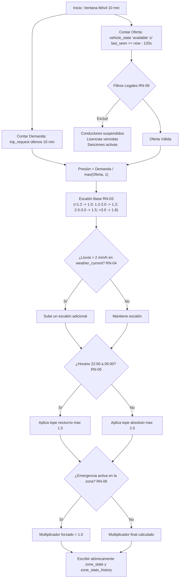

# RutaViva Movilidad · `pressure_worker`

Microservicio de procesamiento asíncrono en segundo plano encargado de consumir eventos de telemetría GPS desde RabbitMQ y calcular de forma reactiva y continua el **índice de presión espacial** y el **multiplicador de tarifa dinámica** por zona de NYC.

---

## 📌 1. Visión General: ¿Qué hace este servicio?

El `pressure_worker` opera como el motor central de tarificación dinámica de RutaViva:
1. **Consume telemetría GPS**: Escucha los mensajes emitidos por el simulador de flota en la cola `telemetria.vehiculos`.
2. **Actualiza la posición de la flota**: Vuelca en lotes de alta velocidad la última posición conocida (`lat`, `lon`, `status`, `last_seen_at`) a la tabla `vehicle_state`.
3. **Evalúa reglas de negocio y restricciones regulatorias**: Determina la oferta vehicular válida (filtrando conductores suspendidos, licencias vencidas y vehículos desconectados) y la demanda en una ventana móvil de 10 minutos.
4. **Calcula el multiplicador**: Aplica los escalones por presión, penalizaciones por lluvia, límites nocturnos y congelamiento por emergencia.
5. **Persiste el estado**: Actualiza atómicamente la tabla `zone_state` e inserta una traza histórica en `zone_state_history`.

---

## 🛠️ 2. ¿Qué se hizo? (Detalle de Implementación)

- **Consumidor Asíncrono de RabbitMQ (`consumer.py`)**:
  - Conexión robusta mediante `aio-pika`.
  - Manejo de flujo con semáforos, *prefetch count* y confirmaciones manuales (`ACK`).
  - Amortiguador (*buffer*) en memoria que agrupa eventos y los inserta en lotes mediante `pg_insert(VehicleState).on_conflict_do_update()`.
- **Motor de Cálculo Matemático (`pressure_calculator.py`)**:
  - Implementación formal de las reglas **RN-02, RN-03, RN-04, RN-05, RN-06, RN-08, RN-09 y RN-10**.
  - Consulta atómica de eventos de emergencia (`special_event`) y lluvia actual (`weather_current`).
- **Arquitectura de Ejecución (`main.py`)**:
  - Ejecución concurrente mediante `asyncio.create_task`: el consumidor de mensajes y el recálculo periódico de zonas corren en paralelo en el mismo bucle de eventos sin bloquearse.
  - Apagado elegante (*graceful shutdown*) capturando señales `SIGINT` y `SIGTERM`.

---

## ⚙️ 3. ¿Cómo se hizo? (Algoritmo y Flujo de Cálculo)

El cálculo del multiplicador por zona se ejecuta estrictamente en este orden matemático:



---

## 🎯 4. ¿Por qué se hizo así? (Justificación Arquitectónica)

1. **Desacoplamiento Total de la API**: Si el cálculo de presión se hiciera de forma síncrona dentro de la `multiplier_api` cada vez que un pasajero consulta un precio, la API colapsaría bajo alta demanda (violando **RNF-01**: p95 $\le 150$ ms con 100 req/s). Con este diseño, la API solo hace un `SELECT` por clave primaria (`zone_id`) en `zone_state`, respondiendo en $< 5\text{ ms}$.
2. **Escrituras en Lotes (*Batching*)**: Guardar 8,000 pulsos GPS de forma individual saturaría el pool de conexiones de PostgreSQL. El consumidor agrupa los mensajes en ventanas de 3 segundos y realiza un único `INSERT ... ON CONFLICT DO UPDATE` masivo.
3. **Idempotencia y Resiliencia**: El worker puede reiniciarse o escalar horizontalmente sin duplicar filas ni corromper estados.

---

## 💡 5. Casos de Ejemplo

### Caso 1: Escenario Combinado Crítico (Criterio de Aceptación CA-02)
- **Condiciones**:
  - Hora: `23:30` (Franja nocturna).
  - Presión calculada: `3.5` (Demanda alta frente a baja oferta).
  - Lluvia: `5.0 mm/h` (Lluvia intensa).
- **Resolución paso a paso**:
  1. Presión $3.5 > 3.0 \implies \text{Escalón base} = 1.8$ (RN-03).
  2. Lluvia $5.0 > 2.0 \implies \text{Sube escalón de } 1.8 \to 2.0$ (RN-04).
  3. Hora 23:30 $\implies \text{Aplica tope nocturno } \min(2.0, 1.5) = 1.5$ (RN-05).
  4. Multiplicador resultante = **1.5**.

### Caso 2: Contingencia de Emergencia (Criterio de Aceptación CA-03)
- **Condiciones**: Presión máxima ($5.0$), lluvia torrencial, pero existe un registro en `special_event` con `is_emergency = true`.
- **Resultado**: El multiplicador devuelto es forzado a **1.0** para garantizar que los ciudadanos puedan evacuar o transportarse sin recargos económicos abusivos.

---

## 🚀 6. Puesta en Marcha y Pruebas

### Ejecución Local

```bash
# 1. Asegurar dependencias y entorno
cd services/pressure_worker

# 2. Iniciar el worker directamente
python app/main.py
```

### Ejecución con Docker

```bash
docker build -t rutaviva-pressure-worker -f Dockerfile .
docker run --rm --network rutaviva-network rutaviva-pressure-worker
```

### Ejecución de Pruebas Automatizadas

```bash
uv run pytest services/pressure_worker/tests/ -v
```
